# AECIP: Adaptive Enterprise Customer Intelligence Platform

**AECIP** is a full-stack, enterprise-grade machine learning platform designed to provide autonomous, real-time customer intelligence. It moves beyond static analytics by implementing an adaptive lifecycle—from data ingestion and feature engineering to model deployment, automated retraining, and cloud-native containerised execution on AWS.

---

## 🚀 Key Features

- **Predictive Analytics**:
  - **Customer Loss Prediction**: Real-time identification of customers at risk of churn.
  - **Customer Lifetime Value (CLV)**: High-precision forecasting of individual customer revenue potential.
- **Autonomous ML (AutoML) & Cloud Retraining**:
  - **Statistical Drift Detection**: Real-time evaluation of data distribution shifts via **Population Stability Index (PSI)** and **Kullback-Leibler (KL) Divergence**.
  - **EventBridge & Lambda Retraining**: Scheduled, autonomous model retraining workflows running on serverless **AWS Fargate** with weights automatically synchronized to **Amazon S3**.
- **AI Decision Intelligence Dashboard**: A premium, dark-mode Streamlit interface including:
  - **Decision Center**: Automated action simulation (retention & win-back campaigns) with priority/urgency signals and ROI estimates.
  - **AI Insights & Explainable AI (XAI)**: Natural language narratives and SHAP-style visual explainability.
  - **Conversational Assistant & Business Impact**: Interactive query assistant and financial ROI modeling.
- **Enterprise Cloud Infrastructure**:
  - **Containerisation**: Production Dockerfiles for Flask API and Streamlit Dashboard with multi-service Docker Compose orchestration.
  - **Amazon RDS for PostgreSQL**: Secure, encrypted relational data store with automated scaling.
  - **Amazon S3**: Versioned, encrypted cloud artifact store for ML model binaries (`.pkl`) and datasets.
  - **Infrastructure as Code (Terraform)**: Modular Terraform scripts provisioning VPC, ECS Fargate, ALB, RDS, S3, ECR, IAM, and CloudWatch.
  - **Automated CI/CD (GitHub Actions)**: End-to-end linting, testing, Docker image build, ECR registry push, and ECS rolling deployments.
  - **Observability**: Centralized Amazon CloudWatch logs, custom metric alarms, and performance dashboards.

---

## 🛠️ Technology Stack

- **Language**: Python 3.10+
- **ML Frameworks**: Scikit-learn, XGBoost, Pandas, NumPy
- **Cloud Platform**: Amazon Web Services (AWS)
  - **Compute**: AWS ECS (Fargate Serverless Containers), AWS Lambda
  - **Storage & DB**: Amazon RDS (PostgreSQL 15), Amazon S3
  - **Networking**: Application Load Balancer (ALB), VPC (Public, Private, DB Subnets)
  - **Registry**: Amazon Elastic Container Registry (ECR)
  - **Automation & Scheduling**: Amazon EventBridge
  - **Monitoring**: Amazon CloudWatch (Logs, Alarms, Dashboard)
- **DevOps & IaC**: Docker, Docker Compose, Terraform (v5.0+), GitHub Actions
- **Visualization**: Streamlit (Executive Dashboard)
- **Backend**: Flask + Gunicorn WSGI (API Layer)

---

## 📁 Project Structure

```bash
├── .github/workflows/ # GitHub Actions CI/CD pipeline (Test, Build, Deploy to ECS)
├── api/               # Flask REST API implementation
├── automl/            # Automated model selection and optimization
├── dashboard/         # Streamlit application for business intelligence
├── database/          # PostgreSQL schema and initialization scripts
├── decision_engine/   # Business logic and strategy recommendation system
├── docs/              # Comprehensive architecture and AWS deployment documentation
├── feature_store/     # Centralized feature definitions and management
├── lambda/            # AWS Lambda handler for automated retraining orchestration
├── models/            # Persistent storage and S3 sync for trained ML weights/artifacts
├── monitoring/        # PSI, KL Divergence drift detection and performance tracking
├── pipelines/         # End-to-end Training and Prediction workflows
├── retraining/        # Autonomous retraining logic
├── storage/           # Amazon S3 storage manager (boto3) with local fallback
├── streaming/         # Kafka producers/consumers for real-time data
├── terraform/         # Infrastructure as Code (VPC, RDS, S3, ECS, ALB, CloudWatch, IAM)
├── tests/             # Unit and integration test suite
├── Dockerfile.api     # Production Dockerfile for Flask API
├── Dockerfile.dashboard # Production Dockerfile for Streamlit Dashboard
├── docker-compose.yml # Local multi-container orchestration
└── main.py            # Unified platform CLI
```

---

## 🚥 Quick Start

### 1. Local Development (Virtualenv)

```bash
# Install dependencies
pip install -r requirements.txt

# Run unit tests
python -m unittest discover -s tests

# Run via unified CLI
python main.py --mode train
python main.py --mode api
python main.py --mode dashboard
```

### 2. Local Containerised Run (Docker Compose)

Spin up PostgreSQL, the Flask API, and the Streamlit Dashboard simultaneously:

```bash
docker-compose up --build -d
```
- **Streamlit Dashboard**: [http://localhost:8501](http://localhost:8501)
- **Flask API**: [http://localhost:5000/health](http://localhost:5000/health)

### 3. Cloud Deployment on AWS (Terraform)

Refer to the complete [AWS Deployment Guide](docs/AWS_DEPLOYMENT_GUIDE.md) for full instructions:

```bash
cd terraform
terraform init
terraform plan
terraform apply
```

---

## 📸 Screenshots

### ☁️ AWS Infrastructure & Docker Containers
| AWS EC2 (`aecip-prod-server`) | AWS S3 Artifacts Bucket |
| :---: | :---: |
| 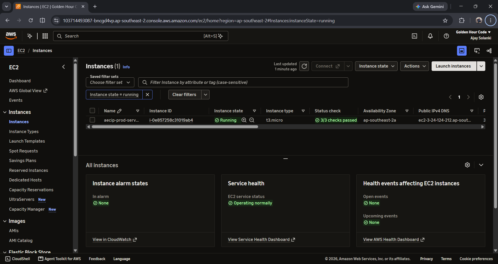 | 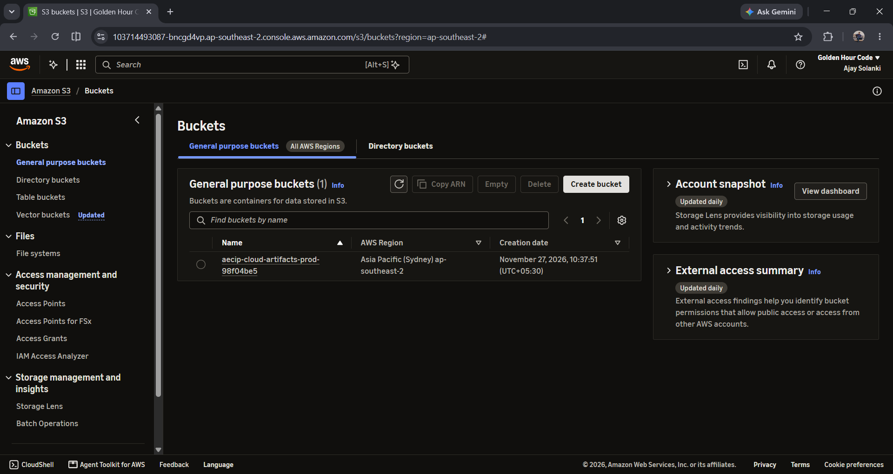 |

| Docker Desktop Containers | Container Health & API Check |
| :---: | :---: |
| 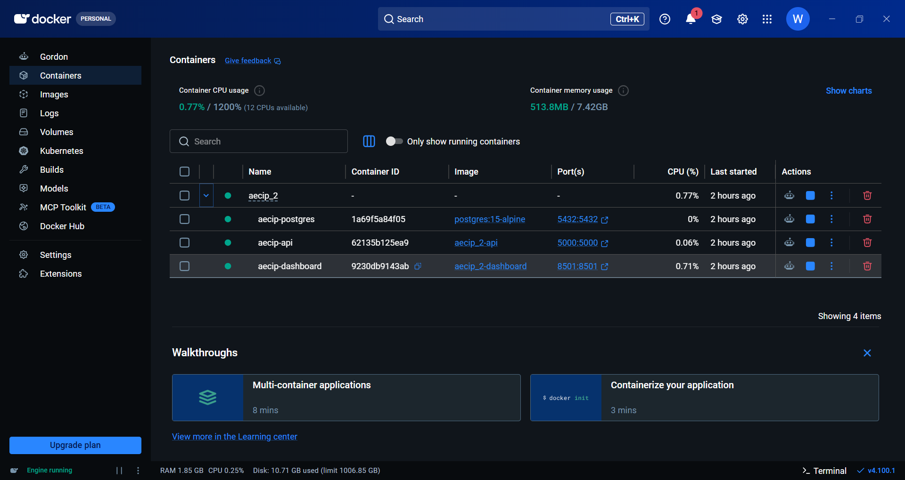 | 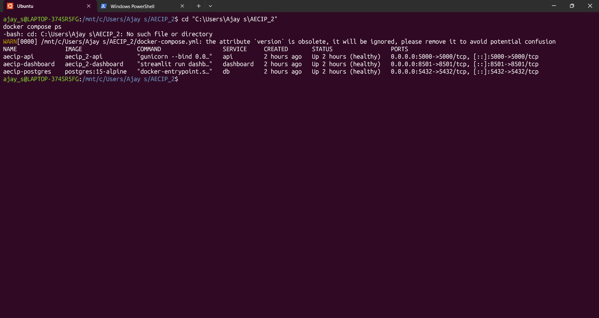 |

### 📊 Dashboard Initialization & Executive Overview
| Platform Initialization | Dataset Processing |
| :---: | :---: |
| 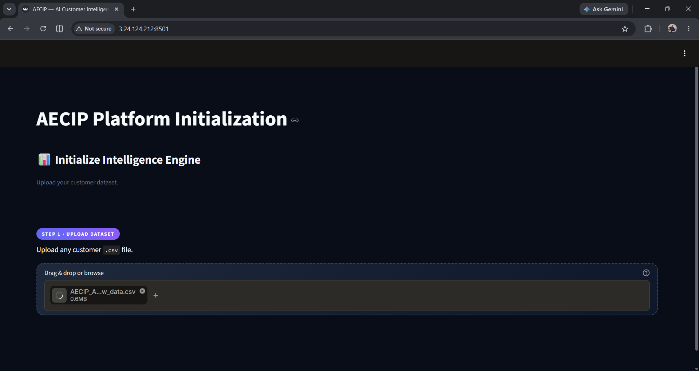 | 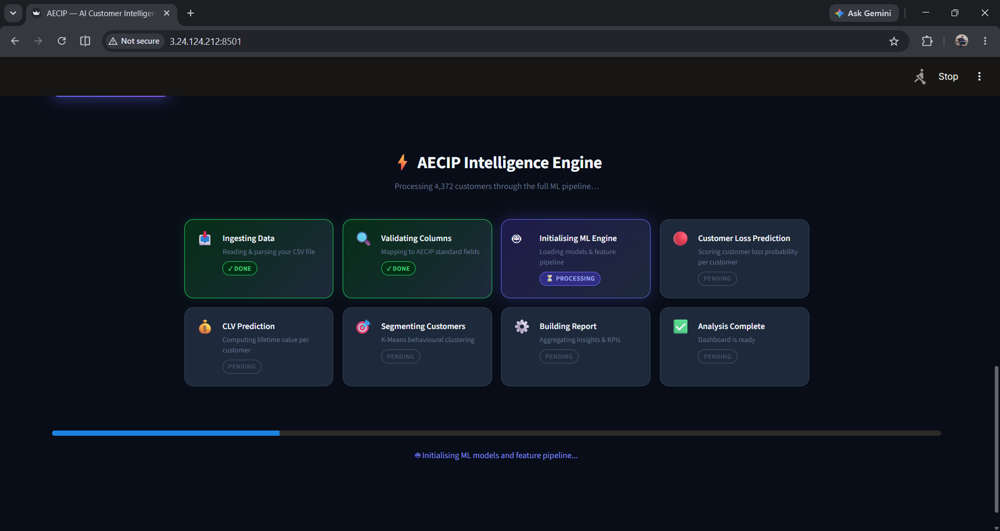 |

| Executive Overview | Customer Segments & Trends | Strategic Drivers |
| :---: | :---: | :---: |
| 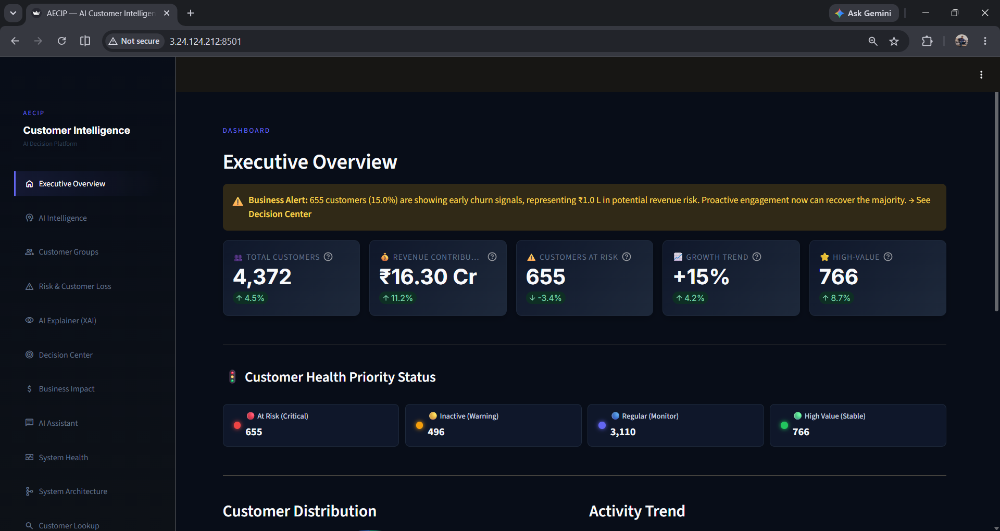 | 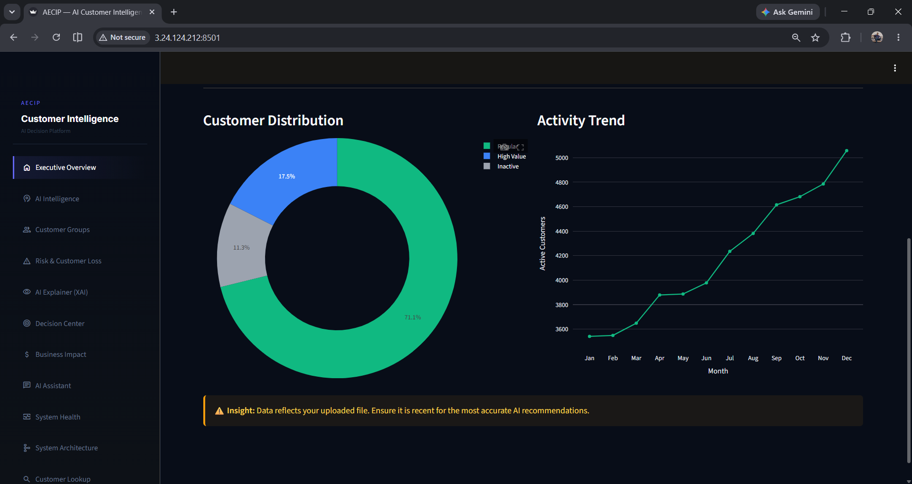 | 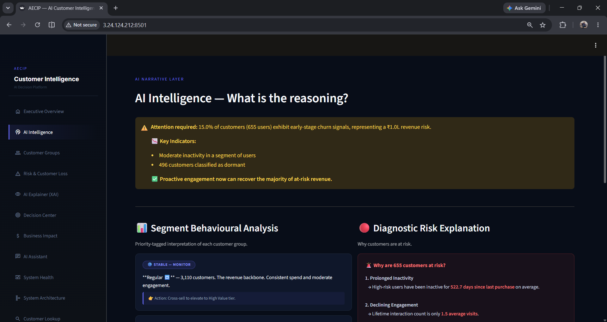 |

### 🧠 AI Insights & Explainable AI (XAI)
| AI Insights | Customer Risk Drivers | Risk Gauge | Explainable AI (XAI) |
| :---: | :---: | :---: | :---: |
| 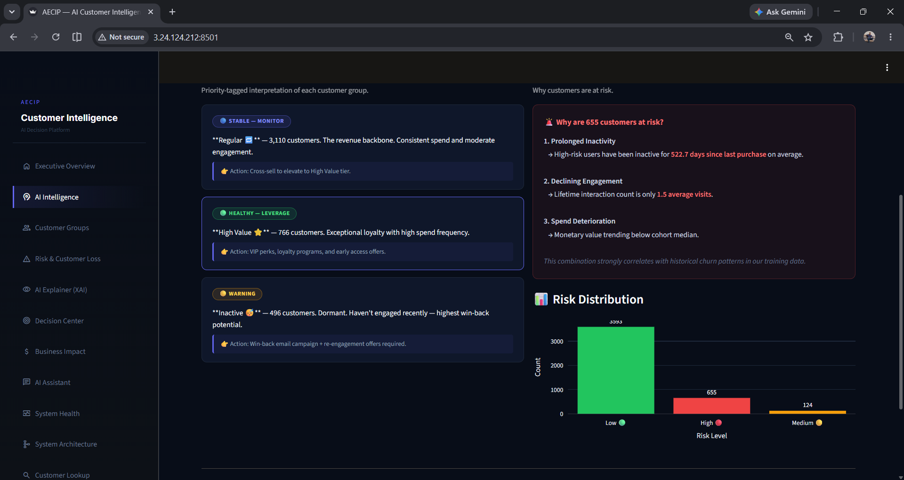 | 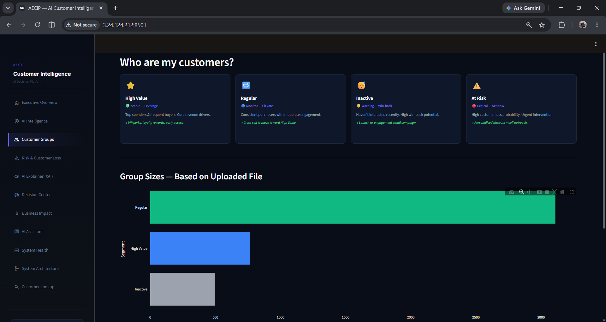 | 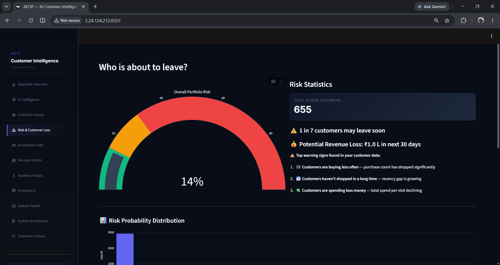 | 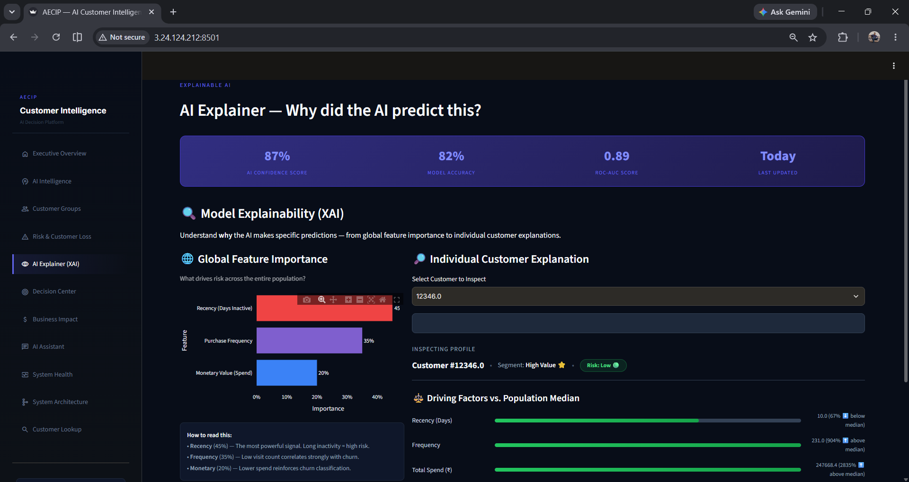 |

### 🎯 Decision Center & Conversational AI Assistant
| Decision Center (1) | Decision Center (2) | Decision Center (3) |
| :---: | :---: | :---: |
| 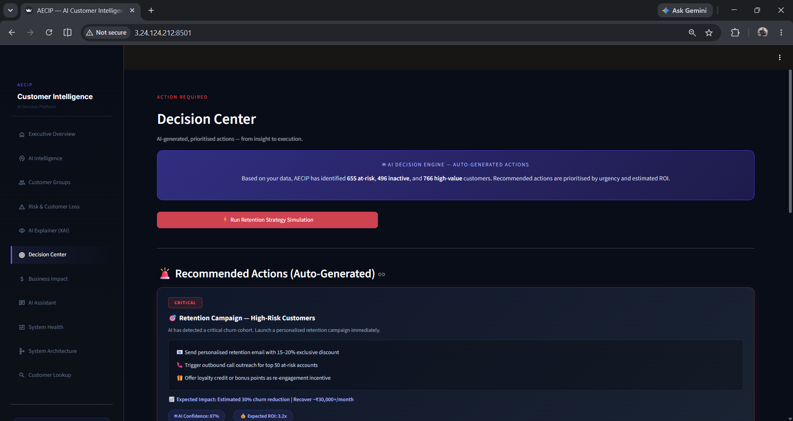 | 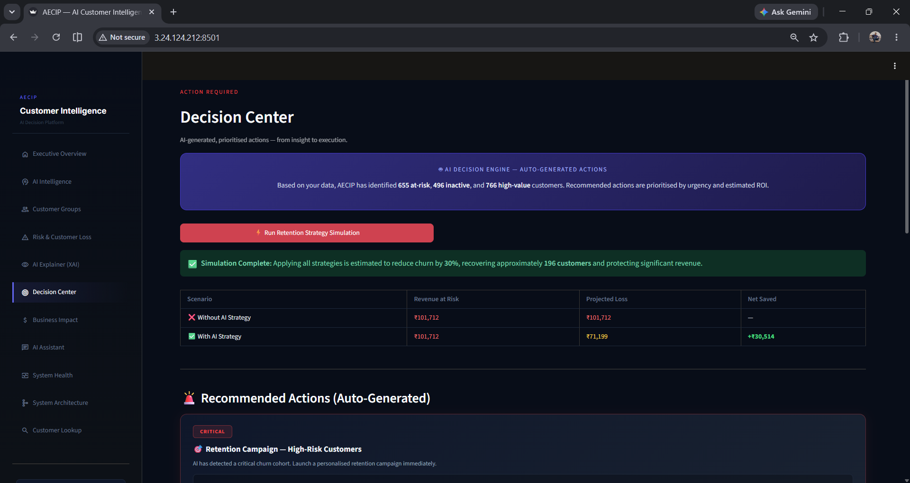 | 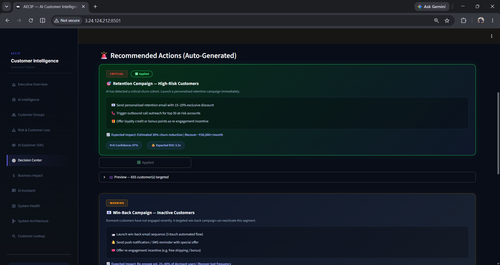 |

| Decision Center (4) | Decision Center (5) | AI Assistant |
| :---: | :---: | :---: |
| 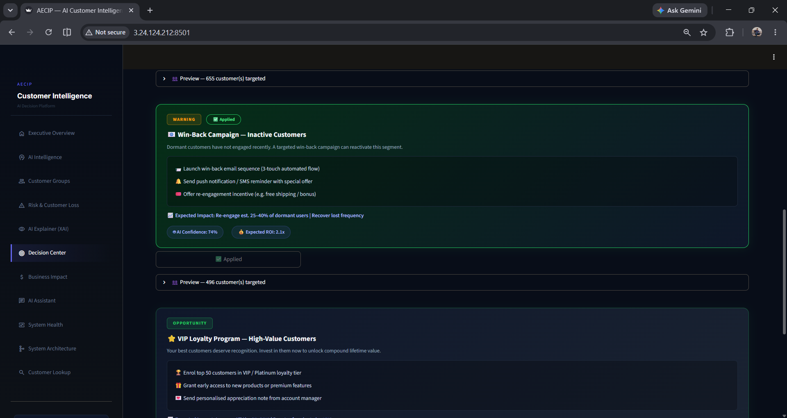 | 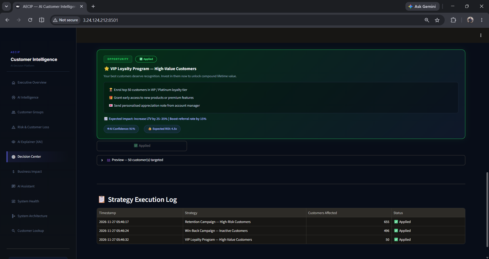 | 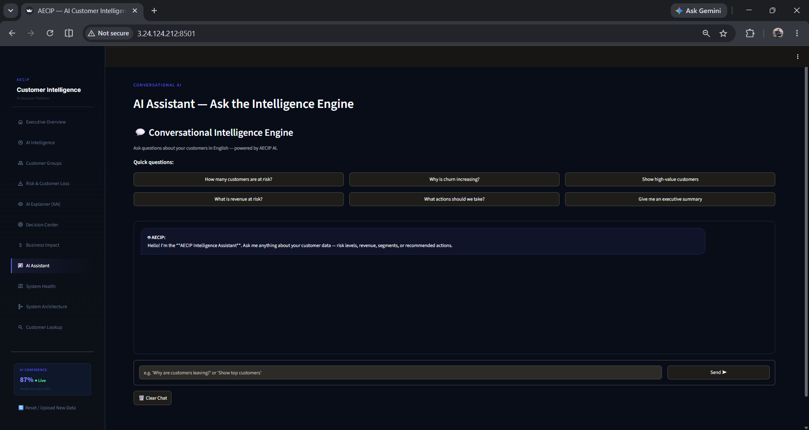 |

---

### Project Vision

AECIP bridges the gap between machine learning and real-world enterprise ROI by delivering a self-healing, cloud-native platform that adapts autonomously to shifting customer behaviors.
